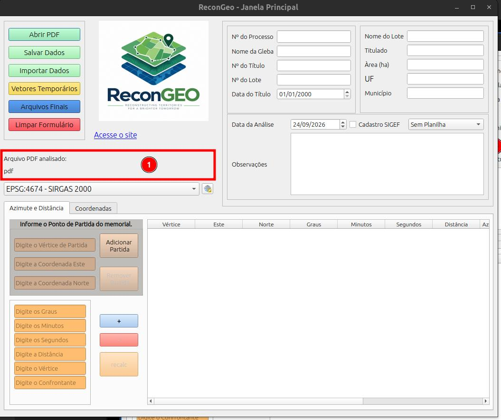

# Arquivo pdf analisado

Quando abrimos um arquivo pdf pelo plugin, o nome aparece na seção **Arquivo PDF Analisado.**

::: {.callout-note}
1. Nome do arquivo PDF analisado
:::

::: {.callout-warning}

É importante acessar os arquivos PDF dos processos por dentro do plugin para que ele possa capturar o local destes arquivos e, posteriormente, criar todos os arquivos finais agrupados numa mesma pasta.

:::