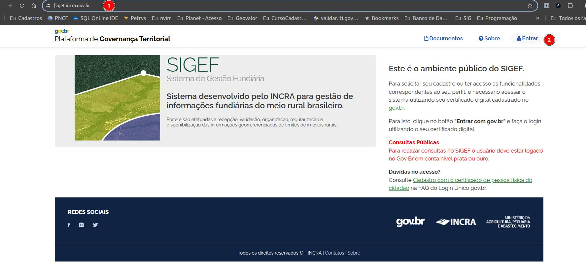
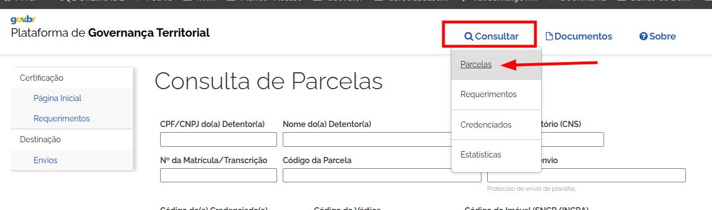
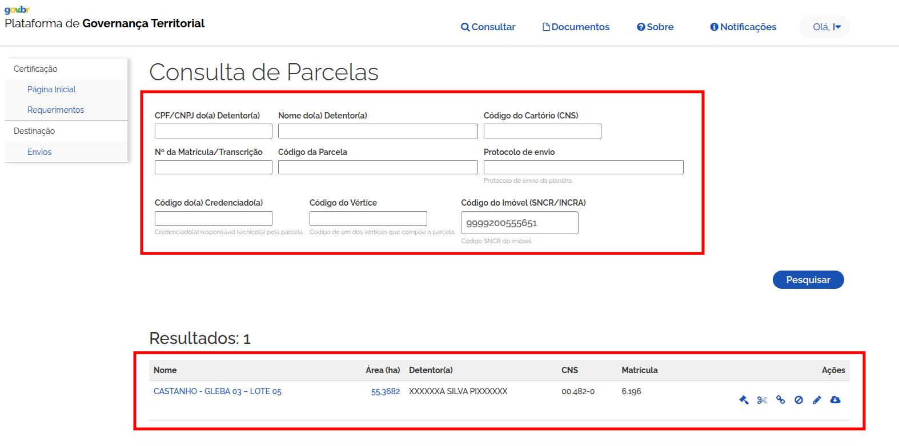
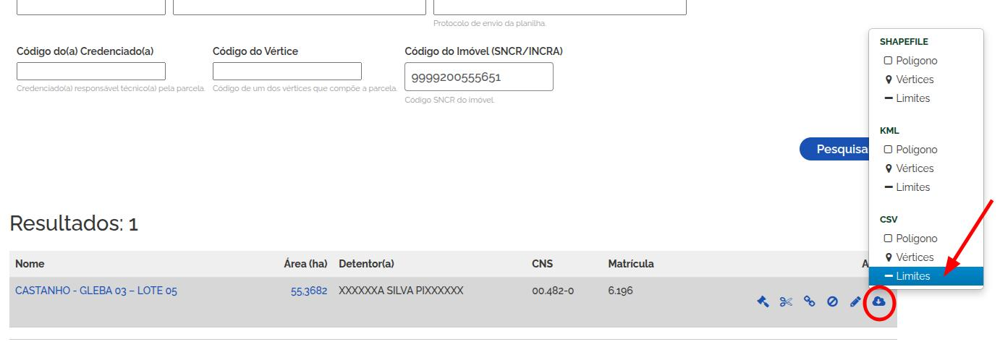
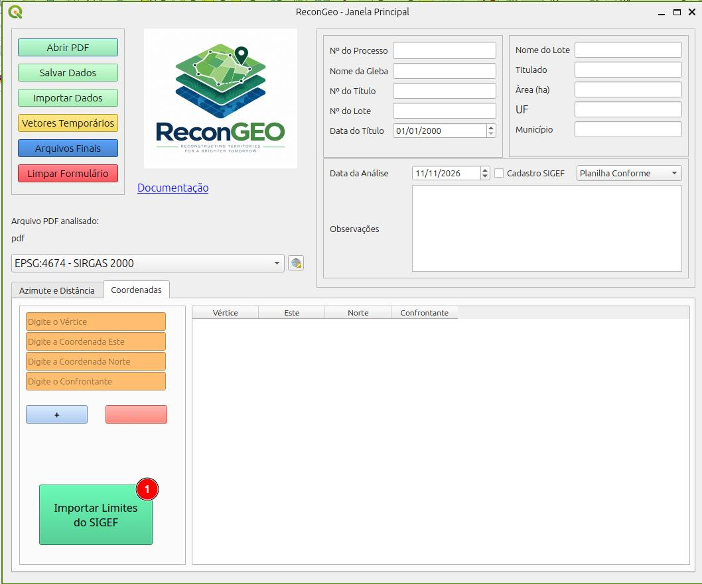
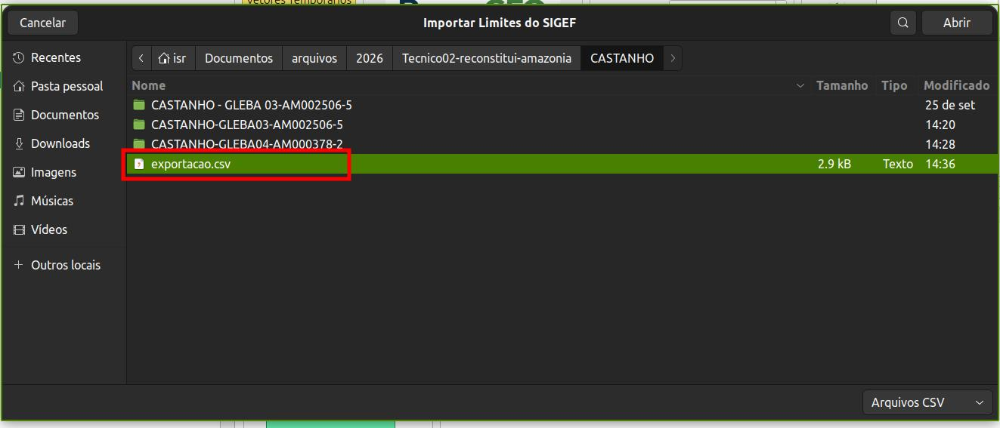
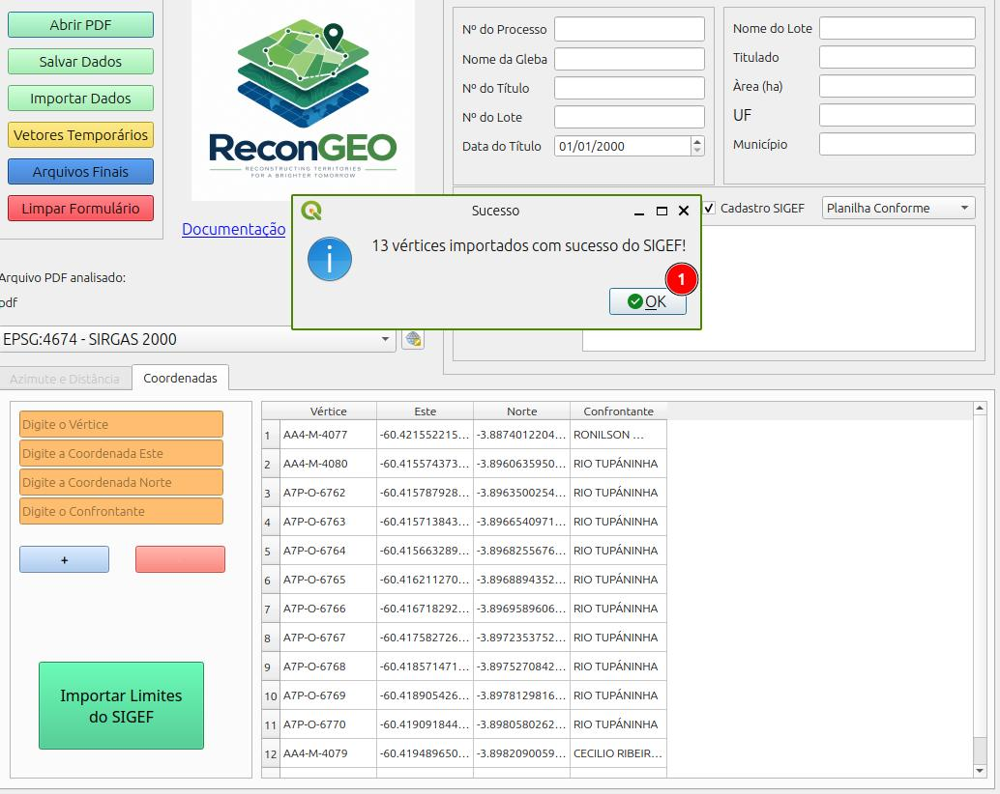

# Importação de dados do SIGEF

## Acessando o SIGEF

Acesso o Sistema de Gestão Fundiária do INCRA através do endereço: [https://sigef.incra.gov.br/](https://sigef.incra.gov.br/)

::: {layout="[[30,70]]"}

::: {.callout-note}

1. Engre na página do SIGEF;
2. Use o seu gov.br para acessar os dados;

:::

Na página do SIGEF, clique em Consultar -> Parcelas.

Use uma das opções de filtro para identificar se existe um pilígono certificado referente ao imóvel em análise.

Na parte de resultados, no lado esquerdo da linha, clique no botão para baixar arquivos, escolha a opção **CSV** -> **Limites**.

Abra o plugin ReconGeo e clique sobre o botão **Importar Limites do SIGEF**

Selecione o arquiv csv baiaxdo da página do SIGEF.

O ReconGeo irá montar a planilha conforme os dados do SIGEF. Lembre-se que os dados baixados encontra-se no sistema de referência SIRGAS2000 (EPSG: 4674).

::: {.callout-note}
1. Pressione **OK** após a importação.
:::

:::

::: {.callout-important}
Utilize as opções **Vetores Temporários** ou **Arquivos Finais** para gerar os vetores.
:::